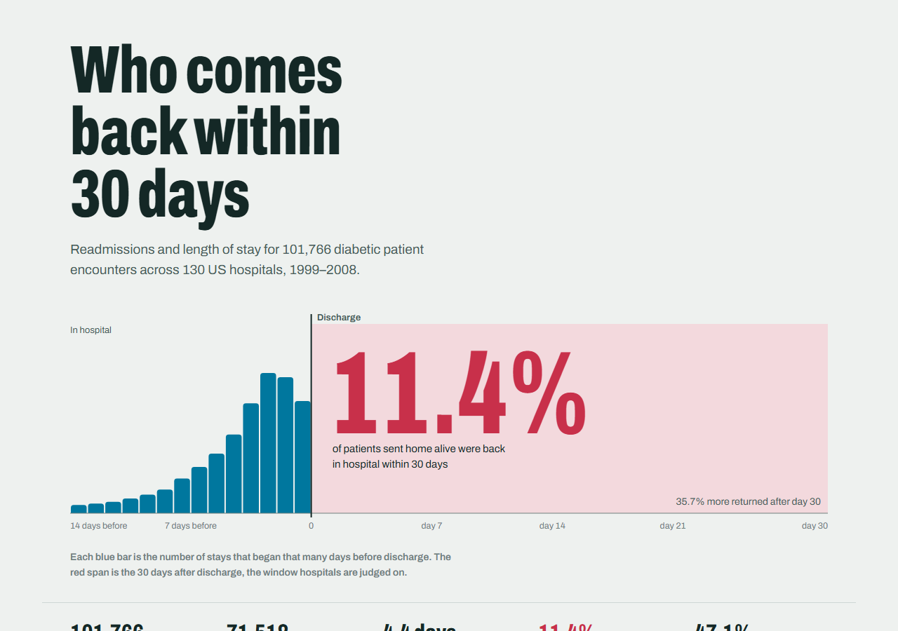
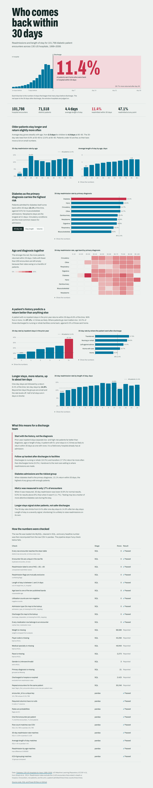
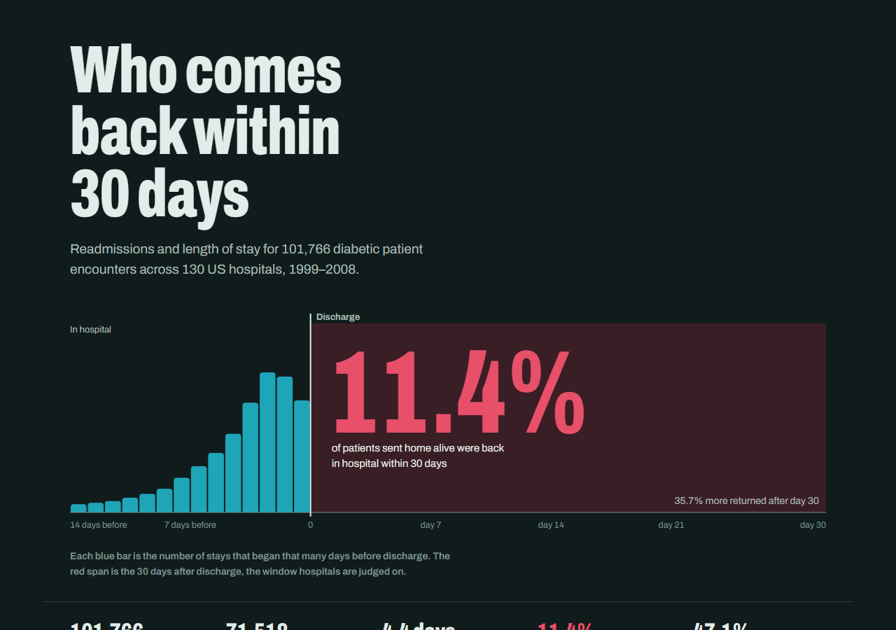
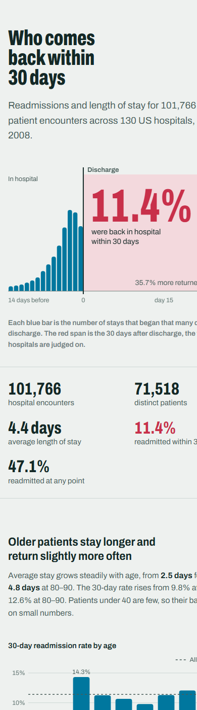

# Diabetes hospital readmissions dashboard

An end-to-end healthcare analytics project on **101,766 hospital encounters for diabetic patients across 130 US hospitals (1999–2008)**. The raw data is loaded into **MySQL**, cleaned and validated in **SQL**, cross-checked in **pandas**, and reported in a **Power BI** model and a public **web dashboard** that GitHub Actions rebuilds and deploys to GitHub Pages on every push. Everything runs on free tools.

**Live dashboard:** https://rishika150.github.io/healthcare-dashboard/



## Key insights

| | Finding | Evidence |
|---|---|---|
| 1 | **11.4% of patients come back within 30 days**, and 47.1% are readmitted at some point. | 99,343 eligible encounters (deaths and hospice discharges excluded) |
| 2 | **History beats diagnosis.** Patients with 5+ inpatient stays in the prior year return within 30 days 37.1% of the time, 4.3× the 8.6% for patients with none. It is the strongest single signal in the data. | `v_readmit_by_prior_inpatient` |
| 3 | **Where patients go next matters.** Transfers (17.3%) and discharges to nursing or rehab (16.3%) are readmitted far more often than discharges home (9.3%). | discharge group breakdown |
| 4 | **Diabetes as the primary diagnosis is the riskiest group** at 13.1%, against 9.5% for musculoskeletal admissions. Circulatory conditions are the most common reason for admission (30% of encounters). | `v_readmit_by_diag` |
| 5 | **Length of stay rises with age**, from 2.5 days for children to 4.8 days at 80–90. The 30-day rate climbs more gently, from 9.8% at 50–60 to 12.6% at 80–90. | `v_readmit_by_age` |
| 6 | **Longer stays signal sicker patients.** The 30-day rate rises from 8.4% after a 1-day stay to 14.8% after a 10-day stay, then levels off. | `v_readmit_by_los` |
| 7 | **HbA1c was measured in only 17% of encounters.** When it was, 30-day readmission was lower (9.8–10.2%) than when it wasn't (11.7%), which suggests testing is a marker of closer diabetes management. | `v_readmit_by_a1c` |

**What a discharge team could do with this:** flag patients with 2+ prior-year admissions at admission time, prioritise follow-up calls for patients discharged to facilities, and treat HbA1c testing as a standard part of every diabetic inpatient stay.

## Screenshots

| Web dashboard (light) | Web dashboard (dark) | Mobile |
|---|---|---|
|  |  |  |

Power BI page screenshots go in `screenshots/powerbi-*.png` once the report is built (see [powerbi/BUILD_GUIDE.md](powerbi/BUILD_GUIDE.md)).

## Architecture

```
UCI zip ──► data/raw/*.csv
              │  scripts/02_load_mysql.py        (pandas → MySQL, everything as text)
              ▼
        MySQL: raw_encounters + 3 lookup tables
              │  sql/02_clean.sql                (types, NULLs, ICD-9 groups, flags, dedupe)
              ▼
        fact_encounter (101,766 rows) + fact_medication (long format)
              │  sql/03_validate.sql             (10 blocking checks, 8 data-quality facts)
              │  sql/04_marts.sql                (8 reporting views)
              ▼
        scripts/04_pandas_validate_export.py     (independent pandas recomputation from raw CSV)
              │
              ├──► data/processed/*.csv  ──► Power BI Desktop (powerbi/)
              └──► docs/data/dashboard.json ──► docs/ web dashboard ──► GitHub Pages
```

## Data cleaning decisions

| Issue in the raw data | What the pipeline does |
|---|---|
| Missing values coded as `?` | Converted to `NULL` (race, payer code, specialty, diagnoses) |
| `weight` is 97% missing | Dropped from analysis, reported in the checks |
| Gender `Unknown/Invalid` (3 rows) | Set to `NULL` |
| `max_glu_serum` / `A1Cresult` = `None` | Relabelled `Not measured` so it isn't confused with a missing value |
| Admission, discharge and source codes are numeric IDs | Joined to `IDS_mapping.csv` and grouped into readable categories |
| ~700 distinct ICD-9 codes in `diag_1` | Grouped into 9 clinical categories following Strack et al. (2014), who published this dataset |
| 2,423 encounters ended in death or hospice | Kept, but excluded from readmission denominators (`is_eligible = 0`) |
| 30,248 repeat encounters for the same patient | Kept; `is_first_encounter` allows a one-row-per-patient view |
| 23 medication columns in wide format | Unpivoted into `fact_medication` (one row per drug actually prescribed) |

## Validation

The pipeline stops if any blocking check fails. The latest run passed all of them.

- **SQL** ([sql/03_validate.sql](sql/03_validate.sql)): row reconciliation raw → clean, unique encounter IDs, valid readmission labels, mutually exclusive flags, length of stay within 1–14, valid age bands, no negative counts, every ID maps to a lookup, no orphan medication rows.
- **pandas** ([scripts/04_pandas_validate_export.py](scripts/04_pandas_validate_export.py)): schema and null checks on the clean table, then the row count, 30-day rate, average stay, per-age rates and ICD-9 grouping are **recomputed straight from the raw CSV** and must match the SQL output to 4 decimal places.

Results are written to `data/processed/validation_sql.csv` and `validation_pandas.csv` and shown at the bottom of the web dashboard.

## Run it yourself

Requirements: Python 3.10+, and MySQL 8 (or let GitHub Actions run it for you).

```bash
pip install -r requirements.txt
```

```bash
cp .env.example .env
```

Edit `.env` with your MySQL host, user and password, then:

```bash
python run_pipeline.py
```

```bash
python -m http.server 8000 --directory docs
```

Open http://localhost:8000. To refresh the screenshots (uses your installed Chrome or Edge in headless mode):

```bash
python scripts/take_screenshots.py
```

## Deployment (free)

1. Push this repository to a **public** GitHub repo.
2. In the repo, go to **Settings > Pages** and set **Source** to **GitHub Actions**.
3. Every push to `main` runs [`.github/workflows/pipeline.yml`](.github/workflows/pipeline.yml): it starts a MySQL 8 container, runs the full pipeline (download → load → clean → validate → export), and deploys `docs/` to GitHub Pages. If a validation check fails, nothing is deployed.

## Power BI

[`powerbi/`](powerbi/) holds the DAX measures, a Power Query script, a report theme matching the web dashboard, and a page-by-page build guide. Power BI Desktop is free; the guide also covers Tableau Public as a free way to publish the report publicly.

## Repository layout

```
├── run_pipeline.py              one command for the whole pipeline
├── scripts/                     download, MySQL load, SQL runner, pandas validation/export, screenshots
├── sql/                         schema, cleaning, validation and reporting views
├── data/processed/              clean tables for Power BI (raw data is downloaded, not committed)
├── docs/                        web dashboard served by GitHub Pages
├── powerbi/                     DAX, Power Query, theme, build guide
├── screenshots/                 images used in this README
└── .github/workflows/           CI pipeline and Pages deployment
```

## Data source and limitations

Strack, B. et al. (2014). *Impact of HbA1c Measurement on Hospital Readmission Rates: Analysis of 70,000 Clinical Database Patient Records.* BioMed Research International. Dataset: [UCI Machine Learning Repository #296](https://archive.ics.uci.edu/dataset/296), licensed CC BY 4.0.

- The data has no admission dates, so there is no calendar trend; "trends" here are across age, diagnosis, and length of stay.
- The `<30` label does not say how many days after discharge the readmission happened.
- Rates are per encounter. A patient admitted three times counts three times; filter on `is_first_encounter = 1` for patient-level analysis.
- These are associations, not causal effects.
